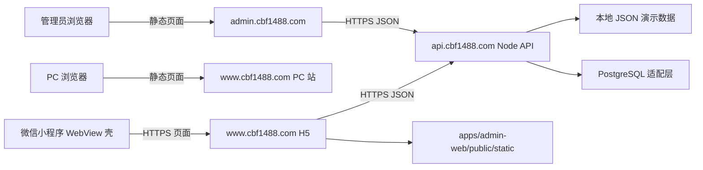

# 工程架构

## 三个工程

| 工程 | 路径 | 职责 | 技术 |
|---|---|---|---|
| 微信小程序 | `apps/mini-program` | 轻量入口、微信容器能力、体验版上传 | 原生小程序 WebView |
| H5/管理后台 | `apps/admin-web` | 小程序 H5、PC 介绍站、管理后台 | Expo + React Native Web + HeroUI Native |
| 统一 API | `services/api` | 身份、权限、比赛、出勤、队员与充值规则 | Node.js + Express |

## 请求关系

H5 通过 HeroUI Native 的 React Native Web 运行，Mini Program 仅装载一个 WebView 页面，避免把 HeroUI 运行依赖和媒体文件放进微信主包。图片现在随 H5 静态构建；开通 CDN 后将资源地址切换到 `cdn.cbf1488.com`。

## 域名

- `cbf1488.com`：根域名跳转到 `www.cbf1488.com`。
- `www.cbf1488.com`：PC 介绍页；`/?surface=mini` 返回小程序 H5 界面。
- `admin.cbf1488.com`：Web 管理后台；当前管理社区业务，后续 CDN 管理功能也放在此管理入口下。
- `api.cbf1488.com`：统一 API。
- `cdn.cbf1488.com`：后续媒体/CDN 域名。

`www`、`admin`、`api`、`cdn` 的备案、DNS、HTTPS 和微信平台配置仍待办理，不在本地代码状态中推定为已完成。

`api.cbf1488.com` 由 HTTP 云函数/API 接收请求；`www.cbf1488.com` 与 `admin.cbf1488.com` 是静态前端站点，需要单独构建并发布。仅部署云函数不会让 `www` 网站可访问。

## API 与云端迁移

API 路由通过 repository 接口使用本地 JSON 或 PostgreSQL。开发默认 `STORAGE_DRIVER=local`，首次启动即生成演示数据；需要数据库开发时可用 Docker Compose 启动本地 PostgreSQL。Lighthouse 使用标准 PostgreSQL TCP 驱动和版本化 SQL migration。当前 CloudBase PG 实例是共享型，应用应使用 CloudBase PG SDK/REST API 适配器（不使用 TCP `pg` 连接串）；如果未来迁移到支持 TCP 的独享 PG/Lighthouse，再使用 PostgreSQL TCP 驱动。CloudBase 阶段部署一个 HTTP 云函数 `cbf1488-api`，由它统一接收 `/api/*`；云函数专属的启动入口放在 `services/api/cloudbase/`，打包后生成到 Git 忽略的 `services/api/.deploy/cloudbase-http/`。所有业务规则仍只维护在 `services/api/src/`，小程序和管理后台也只请求这一套 API。

迁移到 Lighthouse 时，使用 `services/api/Dockerfile` 启动同一份 `src/`，再切换到 PostgreSQL TCP repository 和数据库凭据；不需要复制或重写业务路由。CloudBase shared PG 使用原生 SDK/REST，不等同于 TCP 驱动；CloudBase HTTP 云函数的 API Key 只放在函数环境变量中。云函数启动适配只用于 CloudBase。云函数按无状态服务设计，因此生产文件不能写入本地磁盘，媒体后续应使用 COS。

生产域名不能直接沿用 CloudBase 默认测试域名。备案完成、证书与 DNS 准备好后，再绑定 `api.cbf1488.com` 和静态站域名；当前域名、证书与微信后台配置均未执行。

小程序、H5 和管理后台不直接读写数据库。报名名额与截止时间、队员权限、充值金额和结果公开状态全部由 API 校验。

## 凭据与发布边界

- `.env`、微信 AppSecret、上传私钥及 CloudBase 凭据不得提交。
- 本机秘密统一放在 Git 忽略的 `.local/`；服务端运行变量通过运行环境/CI Secret 注入。
- 默认只运行本地演示。未经显式要求，不执行腾讯云部署、微信上传或平台配置。
- 状态汇报分别记录本地可用、云端已部署、小程序体验版已上传。

CloudBase 参考：[HTTP 云函数 Node.js 快速开始](https://docs.cloudbase.net/cloud-function/quickstart/httpfunc/nodejs)、[HTTP 函数路由](https://docs.cloudbase.net/cloud-function/develop/function-routing)、[文档型数据库与外部连接](https://cloud.tencent.com/document/product/876/46897)、[HTTP 访问服务与自定义域名](https://cloud.tencent.com/document/product/876/122894)。
